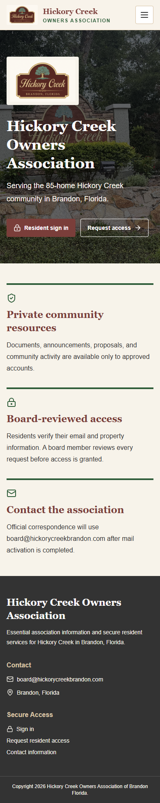
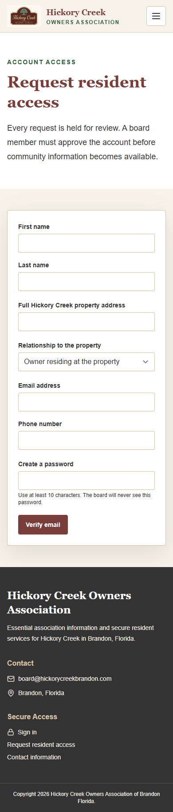
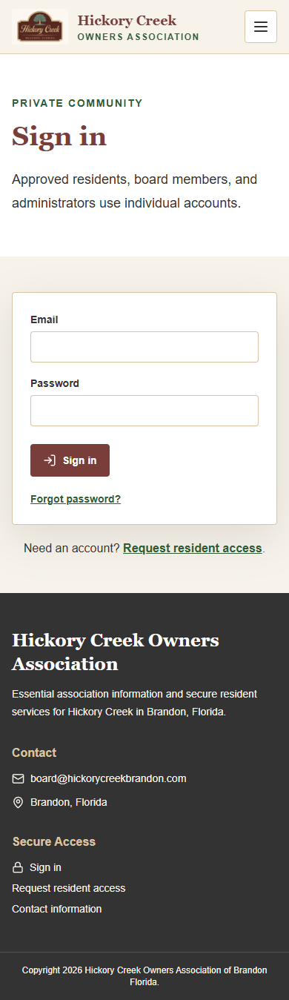

# Secure Portal Administration

This guide is written for a board member who does not work with software every day.

The public home page leads residents to the two account actions:

## 1. Review and approve resident access

1. Open `https://hickorycreekbrandon.com/sign-in/` and sign in with your own board account.
2. Select **Access requests**.
3. Compare the applicant's name, full property address, and relationship to the property against association records. Contact the applicant separately when the information is uncertain.
4. Select **Approve** only after the email and property association are verified. Select **Reject** when the person is not eligible.
5. The portal records the reviewing board member, decision, and time. A resident cannot approve another account, and no request is automatically approved.

Residents begin with this access request screen:

Owners who live elsewhere may use **Owner residing elsewhere**. Tenants and other occupants may use **Tenant or other resident**. The board decides what records are sufficient for each category.

## 2. Add, change, or remove a board member

1. Ask the person to create and verify an account through **Request Access**.
2. Approve the request as a resident.
3. Sign in with an **Administrator** account and open **Administration**.
4. Enter the person's exact account email, choose **Board member**, enter the board title, keep **Active account** checked, and select **Save role**.
5. To remove board access, change the role to **Resident** if the person should retain resident access. To disable all access, clear **Active account**.
6. Never share one board login. Each person uses an individual account so the audit record identifies the actor.

Keep at least two administrator accounts controlled by current officers. Officer titles do not automatically grant administrator privileges.

Every approved user returns through the same sign-in screen:

## 3. Post, update, replace, and archive documents

1. Open **Documents** in the private portal.
2. Enter a title, folder/category, and description.
3. Choose **Residents and board** or **Board only**. Check this choice for every file.
4. Choose the file and select **Upload**.
5. Use **Replace** to upload a new version. The prior version remains in protected storage for history.
6. Use **Archive** to remove a document from normal view without deleting its record.

Files are opened through Firebase while the user is signed in. The site does not create public download-token URLs. Never place private files under the website's `public` folder or in a publicly shared Drive folder.

## 4. Review proposals and initiate a vote

1. Open **Proposals** to review resident submissions and attachments.
2. Discuss whether the item is ready for a board vote.
3. Open **Board votes**.
4. Select the proposal, write the exact motion, choose a deadline, add any board materials, and select **Open vote**.
5. Only a board member or administrator can open a vote. Eligible members are captured when the vote opens.

## 5. Cast, change, close, and review votes

1. Open **Board votes** and locate the open motion.
2. Select **Yes**, **No**, or **Abstain**. Selecting again replaces your current vote until the deadline.
3. Every change is retained in a timestamped history, while only the latest selection is counted.
4. Select **Close vote** after the deadline. Quorum is two-thirds of the eligible board, rounded up.
5. Until the governing majority and abstention rules are confirmed under **Administration**, the portal reports **rule confirmation required** and does not call the motion passed.

## 6. Send and find official correspondence

1. Open **Communications**.
2. Select one or more approved residents, enter the subject and message, and attach files if needed.
3. Select **Send from board@**. The provider credential stays in Firebase and is never shown to board users.
4. The history shows inbound and outbound correspondence plus sent, delivered, bounced, or failed status when provided by Resend.
5. Replies to `board@hickorycreekbrandon.com` appear in the shared history after the inbound webhook is configured.

Do not use the utility-bill Gmail account for this feature. Do not send tests to actual residents without board approval; use board-controlled addresses for setup testing.

## 7. Back up, restore, and transfer management

### Monthly backup

1. In Google Cloud Console, open **Firestore** and export the database to the association backup bucket.
2. In Cloud Storage, keep a second copy of important association documents according to the board's retention policy.
3. In GitHub, confirm the repository is owned by an association-controlled organization or transfer it when officers change.
4. Export Resend message records if the board needs retention beyond the provider's current online history; the portal's Firestore records should also be included in the database export.

### Restore

1. Restore the selected Firestore export from Google Cloud Console.
2. Restore protected files to the same Storage paths referenced by `associationDocuments`.
3. Redeploy Firestore and Storage rules from this repository.
4. Test one resident, one board, and one administrator account before reopening the portal.

### Transfer to a future board

1. Add two incoming officers as administrators and confirm they can sign in.
2. Transfer GoDaddy, GitHub, Firebase/Google Cloud, and Resend ownership to association-controlled accounts.
3. Replace recovery emails, billing contacts, MFA devices, API keys, and webhook secrets.
4. Remove former officers only after the incoming administrators verify all four services.
5. Record the transfer in the board minutes without placing passwords or recovery codes in the minutes.

## Required quarterly access check

Review active residents, board members, administrators, Firebase billing alerts, GitHub collaborators, Resend members, domain renewal, and backup completion. Disable departed users promptly.
